<p align="center"><a href="https://ds-b2b-ai-standards.vercel.app/collection">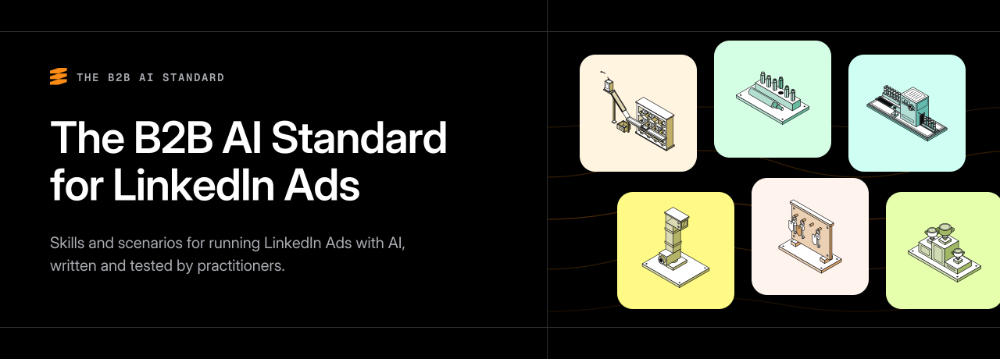</a></p>

<p align="center">
<a href="#licence">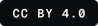</a>
<a href="#needs"></a>
<a href="#install"></a>
</p>

<p align="center"><b><a href="https://ds-b2b-ai-standards.vercel.app/collection">Browse the collection</a></b> · <a href="#install">Install in Claude Code</a> · <a href="#run">Run one in a chat</a> · <a href="https://ds-b2b-ai-standards.vercel.app/rules">Rules</a> · <a href="#licence">Licence</a></p>

Each one reads your exports (or your account through the DemandSense MCP) and tells you what to do. None of them changes anything in your ad account or CRM. Maintained by <a href="https://demandsense.com"></a> [DemandSense](https://demandsense.com).

<a name="scenarios"></a>

##  Scenarios

A whole job, start to finish. Each one is the routine its author runs on client accounts.

<table>
<tr>
<td width="56"><a href="warm-lead-handoff">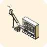</a></td>
<td><a href="warm-lead-handoff"><b>Warm-lead handoff</b></a><br>A short list of who sales should call this week, with one handoff line per account<br><br><a href="https://www.linkedin.com/in/justin-rowe-4043339b/"></a>&nbsp; <b>Justin Rowe</b><br>&nbsp; <sub>Impactable</sub></td>
</tr>
<tr>
<td width="56"><a href="monthly-targeting-review"></a></td>
<td><a href="monthly-targeting-review"><b>Targeting vs who actually buys</b></a><br>Who each campaign paid to reach next to the people on your deals, and where to move budget<br><br><a href="https://www.linkedin.com/in/b2b-marketing-expert/"></a>&nbsp; <b>George Coudounaris</b><br>&nbsp; <sub>The B2B Playbook</sub></td>
</tr>
<tr>
<td width="56"><a href="company-account-routing"></a></td>
<td><a href="company-account-routing"><b>Company-level account routing</b></a><br>Which companies take most of the impressions, which are underserved, and which to move into their own audience<br><br><a href="https://www.linkedin.com/in/joshua-stout/"></a>&nbsp; <b>Joshua Stout</b><br>&nbsp; <sub>Beyond The Funnel</sub></td>
</tr>
<tr>
<td width="56"><a href="audience-fit-check"></a></td>
<td><a href="audience-fit-check"><b>LinkedIn fit gate + daily fit check</b></a><br>A pass, one-more-week or rebuild call on a prospecting campaign, graded by the companies it reached against your ICP<br><br><a href="https://www.linkedin.com/in/jonathan-belliveau/"></a>&nbsp; <b>Jonathan Belliveau</b><br>&nbsp; <sub>GrowthMotiv</sub></td>
</tr>
<tr>
<td width="56"><a href="account-audit-by-cadence">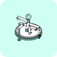</a></td>
<td><a href="account-audit-by-cadence"><b>Account audit by cadence</b></a><br>Eight account checks on a schedule: what to fix today, this week and this month<br><br><a href="https://www.linkedin.com/in/roman-slobodzianyk-b67549140/"></a>&nbsp; <b>Roman Slobodzianyk</b><br>&nbsp; <sub>Impactable</sub></td>
</tr>
<tr>
<td width="56"><a href="signal-list-routine"></a></td>
<td><a href="signal-list-routine"><b>Signal loop</b></a><br>Which named target companies to write to this week, and why now<br><br><a href="https://www.linkedin.com/in/bgdn/"></a>&nbsp; <b>Bogdan Liutic</b><br>&nbsp; <sub>CR8</sub></td>
</tr>
<tr>
<td width="56"><a href="social-signals-to-pipeline">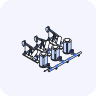</a></td>
<td><a href="social-signals-to-pipeline"><b>Turn social signals into pipeline</b></a><br>Two company lists from engagement on LinkedIn posts: one for sales review, one for nurture<br><br><a href="https://www.linkedin.com/in/alfredo-iscandar-talib/"></a>&nbsp; <b>Alfredo Talib</b><br>&nbsp; <sub>Cornersight</sub></td>
</tr>
<tr>
<td width="56"><a href="conversion-ad-weekly-check"></a></td>
<td><a href="conversion-ad-weekly-check"><b>Weekly check for conversion campaigns</b></a><br>Lead Gen Form and Message ads judged against your goal cost per lead: what to pause and which winners to copy<br><br><a href="https://www.linkedin.com/in/moby/"></a>&nbsp; <b>Moby Hayat</b><br>&nbsp; <sub>Fireshow Media</sub></td>
</tr>
<tr>
<td width="56"><a href="linkedin-campaign-early-read"></a></td>
<td><a href="linkedin-campaign-early-read"><b>LinkedIn Campaign Early Read</b></a><br>A first read 7 to 14 days after launch: delivery, who it reaches, who engages, and the accounts to act on now<br><br><a href="https://demandsense.com"></a>&nbsp; <b>DemandSense</b><br>&nbsp; <sub>&nbsp;</sub></td>
</tr>
</table>

<a name="skills"></a>

##  Skills

One check each. By <a href="https://demandsense.com"></a> [DemandSense](https://demandsense.com) unless an author is named.

### Ads and creative

<table>
<tr>
<td width="56"><a href="cost-per-retargetable-member"></a></td>
<td><a href="cost-per-retargetable-member"><b>Cost per retargetable member</b></a><br>What it costs to add one person to your retargeting audience, and the ad type and objective that do it cheapest<br><br><a href="https://www.linkedin.com/in/wilcoxaj/"></a>&nbsp; <b>AJ Wilcox</b><br>&nbsp; <sub>B2Linked</sub></td>
</tr>
<tr>
<td width="56"><a href="landing-page-cpc-report"></a></td>
<td><a href="landing-page-cpc-report"><b>Landing-page CPC report</b></a><br>What one visit to your site really costs, with ad sets ranked from cheapest to dearest<br><br><a href="https://www.linkedin.com/in/krutainis/"></a>&nbsp; <b>Ivars Krutainis</b><br>&nbsp; <sub>Otter</sub></td>
</tr>
<tr>
<td width="56"><a href="linkedin-creative-fatigue-report"></a></td>
<td><a href="linkedin-creative-fatigue-report"><b>LinkedIn Creative Fatigue Report</b></a><br>Which ads are wearing out, in which ad set, how fast, and whether to pause them<br><br><a href="https://www.linkedin.com/in/ivanfalco/"></a>&nbsp; <b>Ivan Falco</b><br>&nbsp; <sub>Frontal</sub></td>
</tr>
<tr>
<td width="56"><a href="linkedin-creative-performance"></a></td>
<td><a href="linkedin-creative-performance"><b>LinkedIn Creative Performance</b></a><br>Ads ranked by the measure that fits their job, with pause candidates</td>
</tr>
<tr>
<td width="56"><a href="creative-decay-watchlist"></a></td>
<td><a href="creative-decay-watchlist"><b>Creative Decay Watchlist</b></a><br>Ads whose CTR has slid for weeks, and whether the ad or the campaign is the cause</td>
</tr>
<tr>
<td width="56"><a href="video-quality-check"></a></td>
<td><a href="video-quality-check"><b>Video Quality Check</b></a><br>Video campaigns ranked by completion and cost per completed view</td>
</tr>
<tr>
<td width="56"><a href="pausing-low-performing-ads"></a></td>
<td><a href="pausing-low-performing-ads"><b>Pausing Low-Performing Ads</b></a><br>The best ad in a campaign and the ones worth stopping, with the statistics behind each call</td>
</tr>
</table>

### From signal to sales

<table>
<tr>
<td width="56"><a href="no-deal-warm-leads-finder">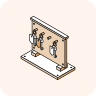</a></td>
<td><a href="no-deal-warm-leads-finder"><b>No-Deal Warm Leads Finder</b></a><br>Engaged companies that are not customers and have no open deal, ranked in tiers</td>
</tr>
<tr>
<td width="56"><a href="whos-looking-at-your-buying-pages"></a></td>
<td><a href="whos-looking-at-your-buying-pages"><b>Who's Looking at Your Buying Pages</b></a><br>Recent visitors to pricing, demo, contact and trial pages, checked against the CRM</td>
</tr>
<tr>
<td width="56"><a href="account-engagement"></a></td>
<td><a href="account-engagement"><b>Account Engagement</b></a><br>Engaged companies tied to pipeline, and the ones missing from the CRM</td>
</tr>
<tr>
<td width="56"><a href="crm-data-health-check">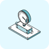</a></td>
<td><a href="crm-data-health-check"><b>CRM Data Health Check</b></a><br>Whether your pipeline data can be trusted: gaps, deal hygiene, win rate by source</td>
</tr>
</table>

### Reach and frequency

<table>
<tr>
<td width="56"><a href="silent-watchers-finder"></a></td>
<td><a href="silent-watchers-finder"><b>Silent Watchers Finder</b></a><br>Companies that saw your ads for three months and never engaged</td>
</tr>
<tr>
<td width="56"><a href="capping-recommendation"></a></td>
<td><a href="capping-recommendation"><b>Capping Recommendation</b></a><br>Impression caps and an exclusion list to stop overexposure</td>
</tr>
<tr>
<td width="56"><a href="linkedin-abm-account-penetration"></a></td>
<td><a href="linkedin-abm-account-penetration"><b>LinkedIn ABM Account Penetration</b></a><br>Which target accounts engage, at what level, and which show nothing</td>
</tr>
</table>

### Who the budget reaches

<table>
<tr>
<td width="56"><a href="waste-budget-detection"></a></td>
<td><a href="waste-budget-detection"><b>Waste Budget Detection</b></a><br>Campaigns that spent in the last 30 days without producing what they were built for</td>
</tr>
<tr>
<td width="56"><a href="linkedin-audience-demographics"></a></td>
<td><a href="linkedin-audience-demographics"><b>LinkedIn Audience Demographics</b></a><br>Who your ads reach and who responds, by seniority, function, title, industry, size, location</td>
</tr>
</table>

### Building the account

<table>
<tr>
<td width="56"><a href="account-health-check"></a></td>
<td><a href="account-health-check"><b>Account Health Check</b></a><br>A ranked list of what to fix first in the account</td>
</tr>
<tr>
<td width="56"><a href="linkedin-performance-kpis"></a></td>
<td><a href="linkedin-performance-kpis"><b>LinkedIn Performance KPIs</b></a><br>Spend, CTR, CPC, CPM and cost per lead against the previous period, with pacing</td>
</tr>
<tr>
<td width="56"><a href="pacing-check-against-schedule"></a></td>
<td><a href="pacing-check-against-schedule"><b>Pacing Check Against Schedule</b></a><br>Campaigns spending off their daily budget or schedule, and what to do</td>
</tr>
<tr>
<td width="56"><a href="budget-re-allocation">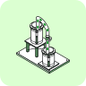</a></td>
<td><a href="budget-re-allocation"><b>Budget Re-allocation</b></a><br>A plan to move budget from ended or paused campaigns to the ones that earn it</td>
</tr>
<tr>
<td width="56"><a href="campaign-group-scoreboard"></a></td>
<td><a href="campaign-group-scoreboard"><b>Campaign Group Scoreboard</b></a><br>Campaign groups ranked by efficiency, with the two best campaigns in each</td>
</tr>
<tr>
<td width="56"><a href="weekly-reporting"></a></td>
<td><a href="weekly-reporting"><b>Weekly Reporting</b></a><br>A weekly breakdown across LinkedIn, Google Ads and Meta, with the main drivers</td>
</tr>
<tr>
<td width="56"><a href="manager-monthly-report">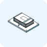</a></td>
<td><a href="manager-monthly-report"><b>Manager Monthly Report</b></a><br>A monthly report: what to optimise, what to stop, how you compare with the market</td>
</tr>
<tr>
<td width="56"><a href="multichannel-performance-rollup">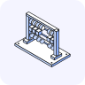</a></td>
<td><a href="multichannel-performance-rollup"><b>Multichannel Performance Rollup</b></a><br>Several ad platforms in one view, with what can and cannot be added together</td>
</tr>
<tr>
<td width="56"><a href="traffic-analysis">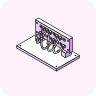</a></td>
<td><a href="traffic-analysis"><b>Traffic Analysis</b></a><br>Where site traffic comes from, paid traffic by campaign, and a UTM tagging audit</td>
</tr>
<tr>
<td width="56"><a href="ad-hoc-query"></a></td>
<td><a href="ad-hoc-query"><b>Ad-Hoc Query</b></a><br>Answers to open questions: what changed, trends, breakdowns, pacing, pipeline</td>
</tr>
<tr>
<td width="56"><a href="linkedin-benchmark-context"></a></td>
<td><a href="linkedin-benchmark-context"><b>LinkedIn Benchmark Context</b></a><br>Your results against your own history first, then market benchmarks</td>
</tr>
<tr>
<td width="56"><a href="benchmark-comparison"></a></td>
<td><a href="benchmark-comparison"><b>Benchmark Comparison</b></a><br>One metric placed inside a published benchmark range for your peer group</td>
</tr>
<tr>
<td width="56"><a href="market-benchmark-comparison"></a></td>
<td><a href="market-benchmark-comparison"><b>Market Benchmark Comparison</b></a><br>Campaign groups compared with a published market benchmark</td>
</tr>
</table>

<a name="run"></a>

##  Run one in a minute

Attach your exports to a chat with Claude (or any assistant that can read a web page) and paste:

```text
Load the Warm-lead handoff scenario from https://github.com/demandsense-labs/linkedin-ads-skills/tree/main/warm-lead-handoff and run it on the exports I've attached.
```

Swap the name and folder for any skill below. Each skill's page on the [collection](https://ds-b2b-ai-standards.vercel.app/collection) lists the exports it needs and gives the same prompt ready to copy.

<a name="install"></a>

##  Install all of them in Claude Code

One command, inside Claude Code:

```text
/plugin install linkedin-ads-skills --marketplace demandsense-labs/linkedin-ads-skills
```

On Claude Code older than 2.1.275, add the marketplace first:

```text
/plugin marketplace add demandsense-labs/linkedin-ads-skills
/plugin install linkedin-ads-skills@linkedin-ads-skills
```

Then ask for what you need ("build this week's warm-lead handoff from these files") or call a skill by name, for example `/linkedin-ads-skills:account-health-check`.

**Just one skill, by hand:** copy its folder into `~/.claude/skills/` (on Windows, `C:\Users\<you>\.claude\skills\`), so the path ends in `account-health-check/SKILL.md`. In the Claude apps, zip the folder and upload it as a custom skill.

<a name="rules"></a>

##  Rules

The Standard's rules say what LinkedIn does by default, and what to do on top of it. There are 15, for example *Read frequency and penetration together* and *Report exposure, influence and attribution separately*. Each rule's page lists the skills and scenarios that apply it: [ds-b2b-ai-standards.vercel.app/rules](https://ds-b2b-ai-standards.vercel.app/rules).

<a name="needs"></a>

##  What each skill needs

Every skill works from the files you attach: Campaign Manager exports, a web analytics export, a CRM export. The skill tells you which files it needs and which checks it cannot run without them. If you use the [DemandSense MCP](https://demandsense.com/mcp-intelligence-hub), the skill can read the same data from your account instead of asking for exports.

<a name="contribute"></a>

##  Contribute

Run a check we don't have? Send a skill, a scenario or a rule as you run it today. We package it, test it with you and publish it under your name, with your company and links: [ds-b2b-ai-standards.vercel.app/contribute](https://ds-b2b-ai-standards.vercel.app/contribute).

Think a skill gets something wrong? [Open an issue](https://github.com/demandsense-labs/linkedin-ads-skills/issues). If testing shows you're right, you're credited as a contributor.

<a name="licence"></a>

##  Licence

The text of every skill and scenario is under [CC BY 4.0](LICENSE): use it, adapt it, also commercially, as long as you credit the author by name, link to the source and the licence, and say what you changed. Each `SKILL.md` names its author, and [AUTHORS.md](AUTHORS.md) gives a ready credit line for each one, for example:

> Warm-lead handoff by Justin Rowe, Impactable, adapted by DemandSense, CC BY 4.0

The plugin manifest in `.claude-plugin/` is under the [MIT License](LICENSE-MIT).

The licence covers the text, not the names: DemandSense and LinkedIn are trademarks of their owners, and a credit line does not mean an author or DemandSense endorses a changed version.

---
LinkedIn is a registered trademark of LinkedIn Corporation or its affiliates. This resource is not sponsored or endorsed by LinkedIn.
