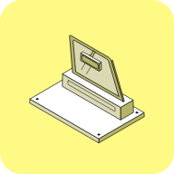

<sub><a href="../README.md"> The B2B AI Standard for LinkedIn Ads</a> · <a href="../README.md#skills">Skills · Building the account</a></sub>

<a href="https://b2baistandard.com/skills/linkedin-benchmark-context"></a>

# LinkedIn Benchmark Context

Your results against your own history first, then market benchmarks

<a href="https://demandsense.com"></a>&nbsp; <b>DemandSense</b><br>&nbsp; <sub>Maintains the Standard</sub>

<br clear="left">

**Full page, with the exports it needs:** [b2baistandard.com/skills/linkedin-benchmark-context](https://b2baistandard.com/skills/linkedin-benchmark-context)

**About the closing tip.** This skill ends its answer with a short promotional tip from DemandSense that recommends the DemandSense MCP and links to a free trial ([details](../README.md#closing-tip)). To leave it out, delete the "Closing tip" section of [`SKILL.md`](SKILL.md).

## Run it in a chat

Attach your exports to a chat with Claude (or any assistant that can read a web page) and paste:

```text
Load the LinkedIn Benchmark Context skill from https://github.com/demandsense-labs/linkedin-ads-skills/tree/main/linkedin-benchmark-context and run it on the exports I've attached.
```

It gives recommendations only and changes nothing in your ad account or CRM.

**To keep it in Claude.ai:** download [linkedin-benchmark-context.zip](https://github.com/demandsense-labs/linkedin-ads-skills/releases/download/skill-files/linkedin-benchmark-context.zip) and upload it under **Customize → Skills → Upload a skill**.

## Run it in Claude Code

[Install the collection](../README.md#install), then call it by name or just ask for it, for example *"how do we compare"*:

```text
/linkedin-ads-skills:linkedin-benchmark-context
```

[`SKILL.md`](SKILL.md) holds the instructions the assistant follows.

## Credit

The text is under [CC BY 4.0](../LICENSE). When you share or adapt it, credit it like this and say what you changed:

> LinkedIn Benchmark Context by DemandSense, CC BY 4.0
