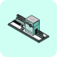

<sub><a href="../README.md"> The B2B AI Standard for LinkedIn Ads</a> · <a href="../README.md#scenarios">Scenarios</a></sub>

<a href="https://ds-b2b-ai-standards.vercel.app/scenarios/signal-loop"></a>

# Signal loop

Which named target companies to write to this week, and why now

<a href="https://www.linkedin.com/in/bgdn/"></a>&nbsp; <b>Bogdan Liutic</b><br>&nbsp; <sub>Founder · CR8</sub>

<br clear="left">

**Full page, with the exports it needs:** [ds-b2b-ai-standards.vercel.app/scenarios/signal-loop](https://ds-b2b-ai-standards.vercel.app/scenarios/signal-loop)

## Run it in a chat

Attach your exports to a chat with Claude (or any assistant that can read a web page) and paste:

```text
Load the Signal loop scenario from https://github.com/demandsense-labs/linkedin-ads-skills/tree/main/signal-list-routine and run it on the exports I've attached.
```

It gives recommendations only and changes nothing in your ad account or CRM.

**To keep it in Claude.ai:** download [signal-list-routine.zip](https://github.com/demandsense-labs/linkedin-ads-skills/releases/download/skill-files/signal-list-routine.zip) and upload it under **Customize → Skills → Upload a skill**.

## Run it in Claude Code

[Install the collection](../README.md#install), then call it by name or just ask for it, for example *"which companies should we write to this week"*:

```text
/linkedin-ads-skills:signal-list-routine
```

[`SKILL.md`](SKILL.md) holds the instructions the assistant follows.

## About the author

Runs CR8, a LinkedIn Ads agency that targets companies by their public buying signals. A performance marketer, he built two businesses to seven figures on performance marketing and sales, wrote the LinkedIn ads playbook for Kyle Poyar's Growth Unhinged, and won Clay's 2026 GTM hackathon.

[LinkedIn](https://www.linkedin.com/in/bgdn/) · [cr8.eco](https://cr8.eco/) · [All authors](../AUTHORS.md#bogdan-liutic)

## Credit

The text is under [CC BY 4.0](../LICENSE). When you share or adapt it, credit it like this and say what you changed:

> Signal loop by Bogdan Liutic, CR8, adapted by DemandSense, CC BY 4.0
