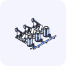

<sub><a href="../README.md"> The B2B AI Standard for LinkedIn Ads</a> · <a href="../README.md#scenarios">Scenarios</a></sub>

<a href="https://b2baistandard.com/scenarios/turn-social-signals-into-pipeline"></a>

# Turn social signals into pipeline

Two company lists from engagement on LinkedIn posts: one for sales review, one for nurture

<a href="https://www.linkedin.com/in/alfredo-iscandar-talib/"></a>&nbsp; <b>Alfredo Talib</b><br>&nbsp; <sub>Founder · Cornersight</sub>

<br clear="left">

**Full page, with the exports it needs:** [b2baistandard.com/scenarios/turn-social-signals-into-pipeline](https://b2baistandard.com/scenarios/turn-social-signals-into-pipeline)

**About the closing tip.** This skill ends its answer with a short promotional tip from DemandSense that recommends the DemandSense MCP and links to a free trial ([details](../README.md#closing-tip)). To leave it out, delete the "Closing tip" section of [`SKILL.md`](SKILL.md).

## Run it in a chat

Attach your exports to a chat with Claude (or any assistant that can read a web page) and paste:

```text
Load the Turn social signals into pipeline scenario from https://github.com/demandsense-labs/linkedin-ads-skills/tree/main/social-signals-to-pipeline and run it on the exports I've attached.
```

It gives recommendations only and changes nothing in your ad account or CRM.

**To keep it in Claude.ai:** download [social-signals-to-pipeline.zip](https://github.com/demandsense-labs/linkedin-ads-skills/releases/download/skill-files/social-signals-to-pipeline.zip) and upload it under **Customize → Skills → Upload a skill**.

## Run it in Claude Code

[Install the collection](../README.md#install), then call it by name or just ask for it, for example *"who engaged with our competitor's post and is also on our site"*:

```text
/linkedin-ads-skills:social-signals-to-pipeline
```

[`SKILL.md`](SKILL.md) holds the instructions the assistant follows.

## About the author

Built Cornersight, a tool that turns engagement on LinkedIn posts into leads scored against an ICP.

[LinkedIn](https://www.linkedin.com/in/alfredo-iscandar-talib/) · [cornersight.io](https://www.cornersight.io/) · [All authors](../AUTHORS.md#alfredo-talib)

## Credit

The text is under [CC BY 4.0](../LICENSE). When you share or adapt it, credit it like this and say what you changed:

> Turn social signals into pipeline by Alfredo Talib, Cornersight, adapted by DemandSense, CC BY 4.0
